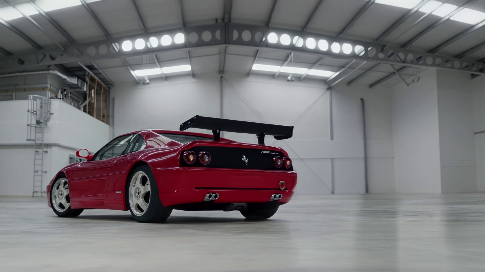
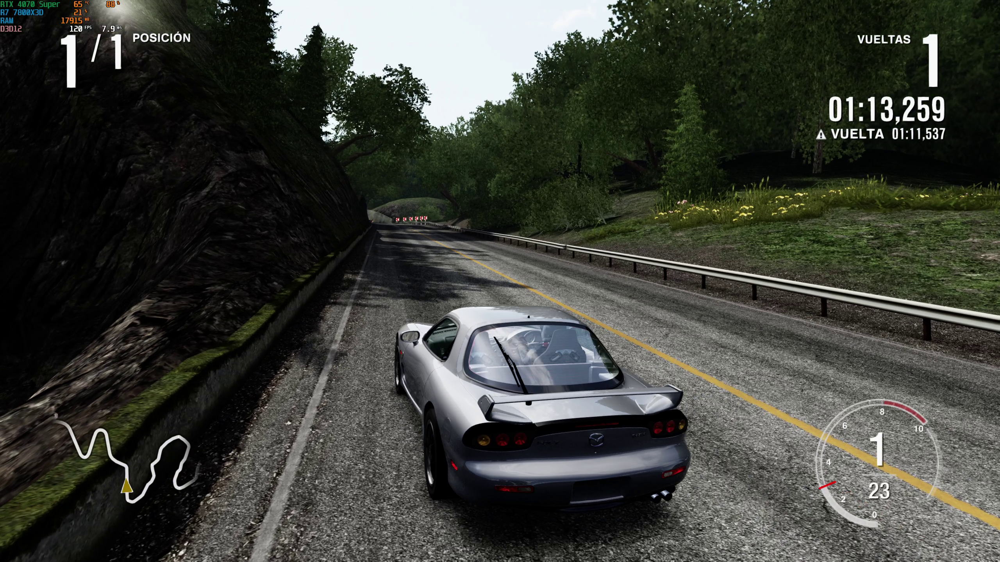
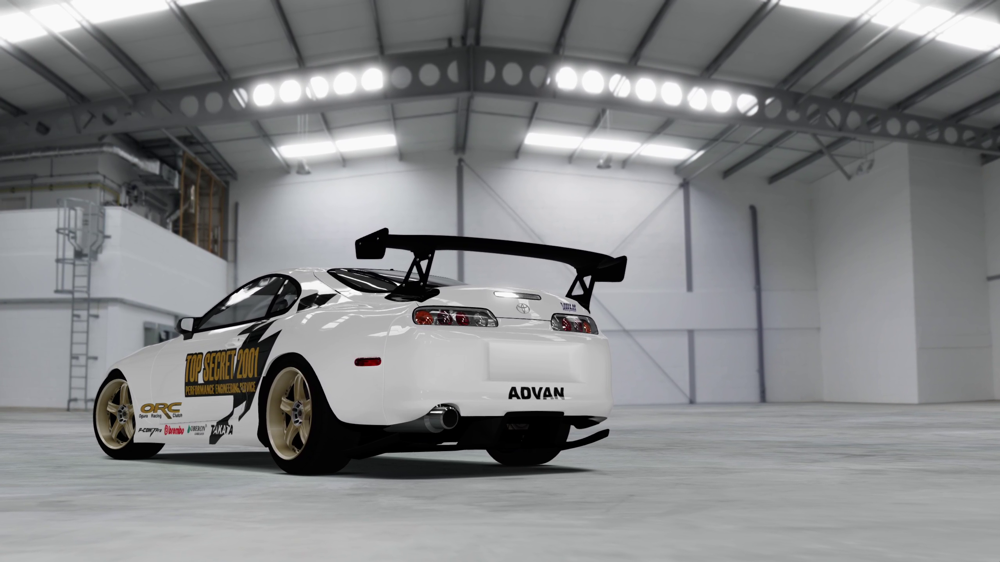

# Forza Motorsport 4 — Native PC Recompilation

Forza Motorsport 4 on Windows, with a dedicated launcher, optional Project Forza Plus 4 integration, and experimental direct-drive wheel support.

[Getting started](#getting-started) · [Supported version](#supported-version) · [Launcher](#launcher) · [Wheels and FFB](#steering-wheels-and-force-feedback) · [Build](#building-from-source) · [Support](#support)



This project translates the Xbox 360 game's PowerPC code into C++ with the [ReXGlue SDK](https://github.com/rexglue/rexglue-sdk). The resulting program runs natively on PC, with the runtime providing graphics, audio, input, profiles, storage and content services.

The launcher guides you through installing both discs, configuring the game, calibrating a wheel and installing or removing Project Forza Plus 4.

> [!IMPORTANT]
> Game files, disc images, DLC and Project Forza Plus archives are not included. Supply your own game discs and mod files.

> [!WARNING]
> This is a work in progress. Menus and races have been demonstrated locally, including gameplay with a MOZA R3 and force feedback. Full Career progression, every game mode, long sessions and other wheelbases still need testing. The 120 FPS mode is experimental and does not guarantee a stable 120 FPS or correct timing in every situation.

## Supported version

The supported executable is **Forza Motorsport 4 (USA), Rev 1**, from the multilanguage Play Disc.

| Identifier | Value |
| --- | --- |
| Title ID | `4D530910` |
| Media ID | `33E7B39F` |
| XEX version | `0.0.0.14` |

The following exact disc images were used for development:

| Disc | ISO size | MD5 |
| --- | ---: | --- |
| Disc 1 — Play Disc, USA Rev 1 | 8,738,846,720 bytes | `2470358250b8566bf5ddc3aaf1b76c68` |
| Disc 2 — Content Install Disc, USA Rev 1 | 8,738,846,720 bytes | `9915d1adaabf3b58441651a70e5e8dbe` |

These hashes identify the **uncompressed ISO files**, not their ZIP archives. The installer also checks the installed Disc 1 files against a SHA-256 manifest. Other regions and revisions have not been validated. Additional hashes and the tested SDK revision are recorded in [doc/inputs.md](doc/inputs.md).

## Getting started

### Requirements

- Windows x64 and a Vulkan-capable GPU for the current Vulkan package.
- Microsoft Visual C++ 2015–2022 Redistributable, x64.
- The supported game discs and enough free space for extraction and content installation.
- Additional space for a separate game/content copy if installing Project Forza Plus 4.

### Install and play

1. Extract the release package into a short folder, such as `C:\Games\FM4`. Keep its executables, DLLs, configuration and PowerShell scripts together.
2. Open **fm4-launcher.exe**. The **Instructions** tab provides the disc hashes and setup steps in English or Spanish.
3. Under **Install → Step 1**, select the **Disc 1 ISO**. Wait for extraction and verification.
4. Under **Step 2**, select the **Disc 2 ISO** to install its four car and track content packages.
5. Choose or create a profile in **Profiles**, adjust graphics and controls, then press **Play**.

Extract game ISOs from their ZIP archives before selecting them. Project Forza Plus uses its ZIP archives directly, as described below.

When updating the port, close the game and launcher before replacing release files. Keep `fm4.user.toml`, `launcher.toml`, your game folders and user data to preserve settings, profiles and saves.

## Launcher

The SDL3 / Dear ImGui launcher has an English/Spanish interface and an integrated setup guide.

| Instructions | Profiles |
| --- | --- |
|  |  |

| Graphics | Controls |
| --- | --- |
|  |  |

### Features

- **Disc installation:** identifies the two supported discs, extracts Disc 1 and installs Disc 2 content with its required licence headers.
- **Profiles:** named offline profiles with separate save directories.
- **Graphics:** fullscreen/windowed output, monitor selection, 16:9 output, quality presets, 1x–4x internal resolution, anisotropic filtering, FXAA/FXAA+, and Bilinear, AMD CAS or AMD FSR output scaling.
- **Frame rate:** default 60 FPS / 60 Hz target and an optional experimental 120 FPS / 120 Hz target.
- **Controls:** SDL/XInput controllers, keyboard bindings and optional mouse-to-right-stick input.
- **Wheel:** guided binding from any USB devices, a live wheel/pedal/button view, native force feedback tuning and SimHub telemetry.
- **Language and audio:** in-game language selection, audio mute, and Automatic, Stereo or 5.1 PCM output.
- **Project Forza Plus 4:** optional installation, original/mod switching and removal with save preservation.

The sidebar shows separate green indicators for the installed game and Project Forza Plus 4. Mod installation is managed under **Install**, without a separate mod tab.

## Steering wheels and force feedback

The launcher's **Wheel** tab is the racing wheel setup from the Pinyon Shift (Forza Horizon 1) port: a guided setup that binds steering, pedals, buttons and an optional H-shifter from **any USB devices** (a direct-drive base with separate pedals, a shifter, a handbrake or a button box), a live view of the wheel, pedals and buttons exactly as the game will read them, and per-row rebinding.

- **Force feedback** is the game's own: FM4's native wheel effects (constant force, spring, damper, friction, inertia) are played on the device you choose, with strength, minimum force, per-effect strength, rumble and direction settings and a left/right Test.
- **SimHub telemetry**: RPM, gear, speed, pedals, wheel slip and suspension in Forza's Data Out layout (Forza Motorsport 7 or Forza Horizon 4/5 in SimHub). See [telemetry](doc/telemetry.md).

Set the rotation in your wheel software first and start with a low strength on a direct-drive base. FM4's clutch is a button: the clutch pedal presses one (B by default); select **Manual with clutch** in the game. Changes apply from the next game start.

`fm4-wheel-probe.exe` lists every device and its raw values without requesting force effects. See [wheel setup and implementation notes](doc/wheels.md). 

In game, the field of view and seat position can be changed live with keys or wheel buttons: see [camera](doc/camera.md). Wide windows (21:9, 32:9) fill with more of the world at the sides and the HUD at 16:9 or at the edges: see [wide screens](doc/wide-screens.md).

## Project Forza Plus 4

Install both discs first. Under **Install → Step 3**:

1. Select `Project Forza Plus 4 v1.3.zip`.
2. Optionally select `Project Forza Plus 4 Update v1.3.zip`.
3. Choose **Normal**, **Hard**, **Sandbox** or **Vanilla** and press **Install Forza Plus**.
4. Once installed, use **Use Forza Plus** or **Use original game** to choose the installation to launch.

| Career mode | Description from the mod |
| --- | --- |
| Normal | Modified progression, endurance World Tour races and unlocked events. |
| Hard | Slower progression, longer races and reduced rewards. |
| Sandbox | Cars and upgrades cost one credit. |
| Vanilla | Original-style career with the mod's car changes; this is still the mod. |

To select another mode, close the game, press **Uninstall Forza Plus**, then reinstall with the new mode. Uninstall removes the mod's separate game files and installed content while keeping its profile saves, settings and the original game intact. Reinstallation reuses the preserved mod user data; it does not reset an existing career.

The adaptation uses separate `.fm4-plus` folders under the selected game and user roots. It retains the port's executable and adapts mod data; it does not run the mod's different-build `default.xex`. Only DLC already installed with the required headers can be adapted. Other bundled DLC is skipped.

With Forza Plus active, selecting 120 FPS applies the supplied physics profile (`CarPhysicsUpdateHz 695`, `TimeScale 1`) when pressing Play. Returning to 60 FPS restores the previous physics file on Play. Extra FOV and harder-AI options are not currently exposed in the launcher. Full compatibility with every mod feature is not established. See [integration and uninstall details](doc/forza-plus.md).

## Gameplay screenshots

| On track | Garage |
| --- | --- |
|  |  |

These captures show individual runs, not a performance guarantee.

## Performance and current limitations

The default is 60 FPS. The optional 120 FPS mode is experimental and requires a game restart. Configure a capable display to 120 Hz or higher in Windows separately; the launcher does not change the desktop refresh rate.

The Vulkan build follows the [Xenia graphics profile](doc/xenia-graphics-profile.md), with a fixed 720p guest video mode and Low, Medium, High and Custom settings. Async shader compilation is enabled, while CPU resolve/memexport readback and postprocess AA are disabled. Custom settings expose render scale, anisotropic filtering and output scaling. The old exterior shadow-map suppression patch is removed in this build. Shader compilation can still cause first-time stalls, and the renderer is not identical to Xenia Canary.

The 60/120 FPS options now set the host presentation limit as well as game pacing. Showroom camera motion uses elapsed time to avoid accelerating at 120 FPS. These fixes do not establish correct timing in every game mode or guarantee sustained 120 FPS. Fullscreen exit now explicitly releases presentation and destroys the SDL window before terminating, addressing the reported desktop HDR dimming.

Long-term Career/save compatibility and complete mode coverage remain work in progress. Profiles are local; Xbox Live functionality is not provided. Please include your game/mod version, hardware, graphics settings and reproduction steps when reporting a problem, plus available logs or crash reports.

More detail: [graphics and timing](doc/graphics-troubleshooting.md) · [bring-up notes](doc/bringup.md).

## Building from source

### Tools and SDK

- Visual Studio 2022 Build Tools with MSVC and the Windows SDK.
- LLVM/Clang, CMake 3.25+ and Ninja.
- An installed ReXGlue SDK compatible with this project's [tested revision](doc/inputs.md) and the runtime changes under [`patches/sdk`](patches/sdk).
- The corresponding SDL3 source tree if building the local haptic-enabled SDL library.
- An extracted supported Disc 1 under `game/disc1/`, including `default.xex`, `XMediaFacade_default.xex` and `SpeechFacade_default.xex`.

There is no `build_sdk.cmd` in this repository. Build/install the SDK separately using its own instructions and review the supplied SDK patches. `scripts/devenv.cmd` currently expects MSVC 2022 Build Tools and LLVM under their standard Windows installation paths; adjust it for other layouts.

From a Windows command prompt in the project directory:

```bat
set "REXSDK_ROOT=C:\SDK\rexglue"

:: Build a local SDL with DirectInput / haptic support for wheel FFB.
scripts\build-wheel-sdl.cmd "C:\src\rexglue-sdk\thirdparty\sdl3"

:: Generate the guest code if needed and build the port, launcher and tools.
scripts\build.cmd release

:: Open the launcher.
out\build\win-amd64-release\fm4-launcher.exe
```

Use the SDL version matching your SDK. The local SDL build/install stays under `out/`; it does not modify the shared SDK. Some prebuilt SDK packages have haptics disabled, so the local wheel-enabled library is required for FFB. `FM4_SDL3_ROOT` can override its install location.

To prepare the game with an already-built `fm4tool`:

```bat
scripts\install_game.cmd "C:\Discs\Disc 1.iso" "C:\Discs\Disc 2.iso"
```

This extracts the discs and installs Disc 2 packages. Supply/extract Disc 1 before code generation when bootstrapping from a clean source checkout; use an existing helper build or a suitable extractor for that initial step. Generated guest code and game files are not included in source control.

### Regression checks

```bat
call scripts\devenv.cmd
cmake --preset win-amd64-release -DCMAKE_PREFIX_PATH="%REXSDK_ROOT%" -DFM4_BUILD_TESTS=ON
cmake --build --preset win-amd64-release
ctest --test-dir out\build\win-amd64-release --output-on-failure
```

The checks cover graphics compatibility/settings, wheel input and calibration, native FFB translation, haptic backend availability, UI polling, and mod install/uninstall/reinstall with save preservation. Automated checks do not certify physical force feedback or complete gameplay compatibility.

## Configuration and command line

| File or folder | Purpose |
| --- | --- |
| `fm4.toml` | Port defaults, copied from `config/fm4.toml`. |
| `fm4.user.toml` | Player settings, paths, wheel calibration and active profile. |
| `launcher.toml` | Launcher language and profile list. |
| `game_files.sha256` | Disc 1 verification manifest. |
| `cover.jpg` | Cover artwork extracted from Disc 1. |
| `user/<XUID>/` | Per-profile data in the selected user root. |
| `logs/` | Runtime logs and crash reports; clean-exit logs may be removed by the launcher. |

The game reads the configuration files next to its executable. The launcher also supports:

```text
fm4-launcher.exe --import-iso <iso> --game-dir <dir> --user-dir <dir> [--log <file>]
fm4-launcher.exe --verify --game-dir <dir> [--log <file>]
fm4-launcher.exe --screenshot <file.bmp> --tab instructions|profiles|graphics|controls|audio|install|support --lang en|es
```

## Project layout

| Path | Purpose |
| --- | --- |
| `fm4_manifest.toml` | Game executable/DLL inputs and code-generation output. |
| `config/` | FM4 code-generation configuration and runtime defaults. |
| `src/` | Game application, compatibility hooks, wheel input and FFB. |
| `launcher/` | Graphical interface, settings, profiles and installation. |
| `scripts/` | Build, extraction, mod installation and uninstallation. |
| `tools/fm4tool/` | Disc extraction, content installation and image inspection. |
| `tests/` | Regression fixtures and checks. |
| `doc/` | Implementation notes and setup documentation. |
| `doc/img/` | Launcher and gameplay screenshots. |
| `patches/sdk/` | Runtime changes required by the SDK integration (0006: wide-screen HUD placement, video mode from window, thunk reuse). |

## Antivirus report

The **v0.3.7 release ZIP** (`FM4-v0.3.7`) has a public
[VirusTotal report](https://www.virustotal.com/gui/file/01e3845826e223cd2d207f08fb9259292d721469886decf955be0a04c6407bf5/detection).

SHA-256: `01e3845826e223cd2d207f08fb9259292d721469886decf955be0a04c6407bf5`

At the time the report was shared, the maintainer reported one detection,
suspected to be a false positive. That assessment has not been independently
confirmed; an unsigned application alone does not establish the cause of an
antivirus detection. Consult the linked report for current results. This report
applies to the exact ZIP identified above, not to future releases or modified
files, and is not a guarantee of safety.

## Support

If you would like to support development or follow updates:

**[Forza Motorsport 4 on PC — Ko-fi](https://ko-fi.com/post/Forza-Motorsport-4-on-PC-Native-Port-Moza-R3-I3B028W026)**

## Credits and legal notice

Built on [ReXGlue](https://github.com/rexglue/rexglue-sdk), [Xenia](https://github.com/xenia-project/xenia) and [XenonRecomp](https://github.com/hedge-dev/XenonRecomp). The launcher and project setup build on the earlier [Forza Motorsport 3 port](https://github.com/0herculabs/hl360-forza3). Project Forza Plus 4 belongs to its respective creators and is supplied separately.

This is an independent community project, not affiliated with or endorsed by Microsoft or Turn 10 Studios. Forza Motorsport and the game assets belong to their respective owners.
